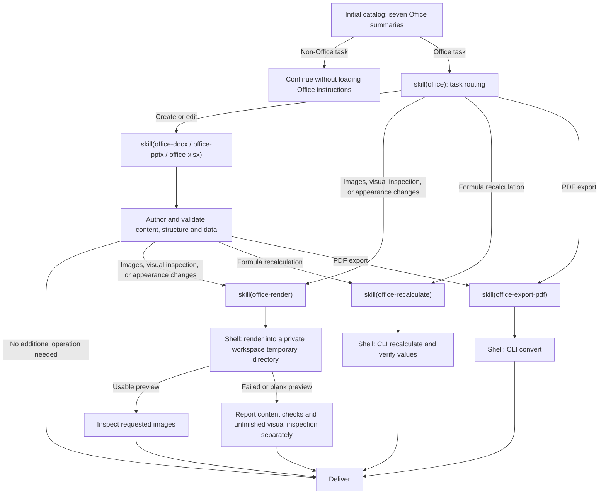

# @deepseek-ai/dsh-skill-office

English | [中文](README.zh.md)

## Summary

The catalog lists the Office router and six authoring or operation skills. Full instructions load on demand. Skills use `office-check` and `dsoffice` through existing shell tools without exposing interpreter or package paths. SDK and Desktop each mount the skill provider, command plugin, and dependency query; ordinary Web does not mount them by default.

## Table of Contents

- [Use this package](#use-this-package)
  - [Progressive loading](#progressive-loading)
- [Understand the implementation](#understand-the-implementation)
- [Further Exploration](#further-exploration)
- [Model Experience](#model-experience)
- [Known Limitations and Deferred Work](#known-limitations-and-deferred-work)
- [Dev Note](#dev-note)

-----

<a id="use-this-package"></a>
## Use this package

Mount the skill provider beside the skill registry and `dsh-tool-skill`, and the command plugin beside `dsh-shell-env`. The provider supplies instructions and checker resources; the command plugin makes `dsoffice` and `office-check` available to local Bash and PowerShell tool calls.

```yaml
- name: '@deepseek-ai/dsh-skill-office'
- name: '@deepseek-ai/dsh-skill-office/commands'
```

| Field | Default | Meaning |
|---|---|---|
| `assetRoot` | Carrier resources or packaged `assets/` | Absolute directory containing the seven skill folders and shared `scripts/`. |

Invalid skill assets reject registration. Loading instructions does not resolve interpreters or prepare engines. Bash or PowerShell owns approvals, sandboxing, cancellation, and output management. Resources and execution tools must refer to the same host.

The command plugin accepts separate configuration:

| Field | Default | Meaning |
|---|---|---|
| `command` | Carrier or installed Kit | Executable and fixed arguments for `dsoffice`; `false` omits that command. |
| `checkCommand` | Configured Python checker | Executable and fixed arguments for `office-check`; `false` omits that command. |
| `assetRoot` | Carrier resources or packaged `assets/` | Directory containing the shared checker and skills. |

Command overrides require an absolute executable as their first argument. Launchers receive the caller's remaining arguments unchanged and live only while the command plugin is mounted. Windows launchers preserve empty arguments, embedded quotes, trailing backslashes, and Unicode paths on Windows PowerShell 5.1 and PowerShell 7; PowerShell arrays supplied as one argument become comma-separated text. Launchers accept input file paths and do not forward pipeline input. A missing executable returns a nonzero exit code. The shell environment prepends their private directory to each tool call's `PATH`; it does not change the process or user's shell configuration. Disabling a command does not prevent skill loading. `office-check` directly runs the Python checker with the selected carrier interpreter or explicit `checkCommand`; it is omitted when neither is supplied. The checker uses only Python standard-library modules. Command registration and execution neither prepare nor copy a runtime. The general `load_workspace_dependencies` tool supplies authoring interpreters and libraries independently.

`DSH_PRIMARY_RUNTIME` selects authoring and checker resources. Kit commands use the carrier's Node.js when supplied, otherwise the host Node.js, so Python-only authoring payloads are supported.

<a id="progressive-loading"></a>
### Progressive loading

The model chooses skills from the task; the host does not inject complete instructions based on file extensions. All seven skills are listed and loadable by name through `skill` or explicit user invocation. Requested appearance changes, including spreadsheet cell fills and text alignment, require rendering even without an explicit visual-check request; an explicit request to skip rendering takes precedence. Pure operations can enter the corresponding skill directly.



New files and content, data, or formula edits do not require rendering solely because they include incidental basic formatting. Preview images use a private, randomly named temporary directory inside the workspace and are removed after inspection. Loaded instructions remain in session history after an operation finishes. The diagram describes ordinary presets across supported clients; it does not change the shell-only definition of minimal or sdk-minimal.

### Structural checks

`office-check <file> --out <report.json>` reads DOCX, PPTX, and XLSX without changing the source. The shared Python checker validates ZIP/XML and internal relationships, summarizes document structure, and optionally checks required text or slide/sheet counts. It requires only the Python standard library. Invalid files and report-write failures return a JSON failure report. Structural success does not establish appearance, feature preservation, or calculated formula values.

-----

<a id="understand-the-implementation"></a>
## Understand the implementation

<details>
<summary>Implementation internals — click to expand</summary>

The provider reads descriptions at registration and bodies on demand. Registry precedence, scope, and invocation permissions apply to every skill. Each loaded skill includes its resource directory for relative references. Disposal unregisters all candidates.

The provider registers no tools or activation projection. Loaded skill results remain logged through the generic skill loader. Resume and fork use existing session history and tool declaration reconciliation. The command plugin hides carrier-specific executable paths behind local launchers and registers their directory with the shell environment; disposal removes both the contribution and the directory. Windows launcher directories support long `DSH_HOME` paths; `PATH` entries use ordinary absolute paths. When an executable path exceeds the Windows process launch limit, the plugin temporarily links its parent directory through a short path under the system temporary directory and removes that link on disposal.

| File | Responsibility |
|---|---|
| [`src/index.ts`](src/index.ts) | Resource registration and unchanged skill bodies. |
| [`src/commands.ts`](src/commands.ts) | Local launchers, carrier selection, and shell environment contribution. |
| [`assets/`](assets/) | Router, six subskills, and read-only OOXML checker. |

</details>

-----

<a id="further-exploration"></a>
## Further Exploration

- [Skill registry](../skill/README.md) — discovery and precedence.
- [Skill tool](../tool-skill/README.md) — model catalogs and loaded bodies.
- [Shell environment](../../shell/shell-env/README.md) — command directories and managed variables.
- [File delivery](../../deliverables/tool-present/README.md) — current source-path delivery.

-----

<a id="model-experience"></a>
## Model Experience

Indirectly, through `dsh-tool-skill`, which renders the initial Office summary and returns routing or selected subskill instructions from `skill(name)`.

#### KV Cache effect

Skill results append to history without changing tool declarations, and loaded text or images remain after an operation finishes. Character estimates use `ceil(characters / 4)`: the summary is at most 50 tokens and the router body at most 200; authoring bodies are at least 35% smaller than the combined authoring and operation guides. Skill wrappers, the generic catalog, shell declarations, and `load_workspace_dependencies` are separate costs, and these estimates are not server usage.

## Known Limitations and Deferred Work

<a id="known-limitations-and-deferred-work"></a>

- The provider does not install authoring libraries. The checker needs Python 3.9 or later.
- LibreOffice output can differ from native Office applications; structural checks cannot certify appearance.
- Legacy, encrypted, and macro-enabled files need an appropriate separate workflow.

<a id="dev-note"></a>
### Dev Note

<details>
<summary>Working context for maintainers — click to expand</summary>

None.

</details>
